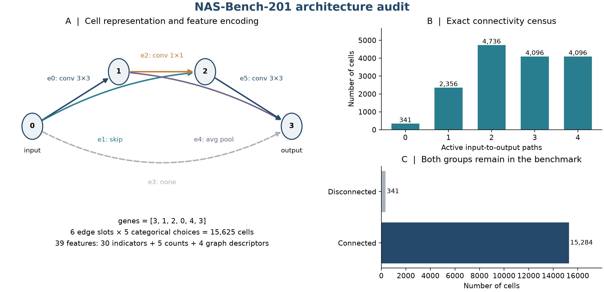
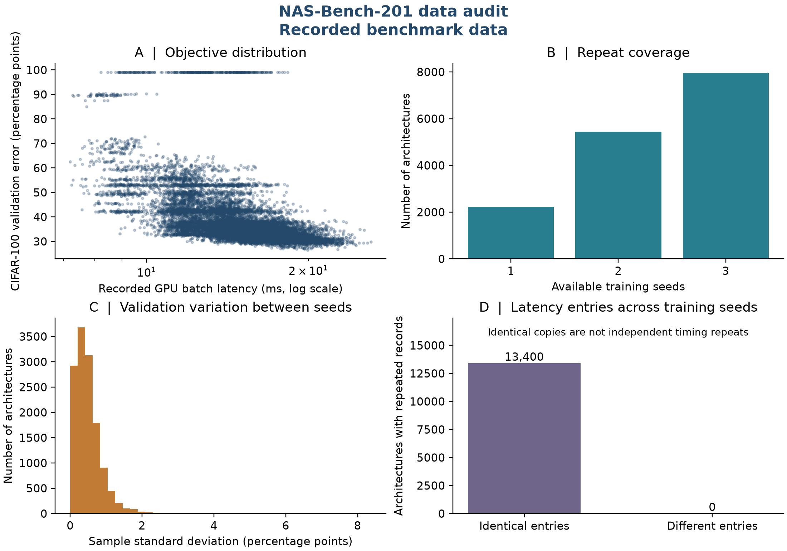

# Part 1 · Benchmark loading, architecture encoding, and data checks

## Abstract

We prepare a deterministic experimental reference for studying how evaluation error changes multi-objective architecture search. NAS-Bench-201 supplies recorded evaluations for a finite space of 15,625 cell encodings. The selected objectives are CIFAR-100 final validation error and recorded GPU batch latency. The pipeline preserves official identities, individual training seeds, and recorded latency entries; exposes categorical and structural features; and verifies exported tables before use. Exhaustive representation checks pass for the entire space. The official source yields 36,986 training trials and 15,625 eligible architectures. Every exported objective mean matches the authors' API, and 66 tests pass. The processed tables and measured-data audit accompany the implementation.

## Benchmark and extraction

The protocol is fixed to the original NAS-Bench-201 v1.1 file, CIFAR-100, the 200-epoch training schedule, validation split `x-valid`, and final epoch index 199. Network metadata must specify channel 16, num_cells 5, and 100 classes. Zero-padded trial labels such as `"0777"` are normalized to their integer seed key `777`; a mismatched identity is rejected. The extraction does not use `x-test` or `ori-test`. The latter combines validation and test data on CIFAR-100 and must not replace validation accuracy.

For architecture i, let S_i be its available training seeds and a_is the final validation accuracy in percent. The first objective is:

\[
f_1(i)=100-\frac{1}{|S_i|}\sum_{s\in S_i}a_{is}.
\]

For seed s, the stored latency entries are first averaged to l_is in seconds. Let V_i contain seeds with positive recorded mean latency. The second objective is:

\[
f_2(i)=1000\,\frac{1}{|V_i|}\sum_{s\in V_i}l_{is}.
\]

This order gives each available training trial equal weight, matching the authors' API; pooling all repetitions would overweight trials with more timing samples. Nonfinite measurements cause extraction to fail. Absent or nonpositive trial latency remains recorded but does not enter its mean. Architectures with no usable latency remain in the table with an explicit eligibility flag. All experiments must share the resulting eligible IDs. Both objectives are minimized.

The original file is read with a projected legacy-pickle reader to keep memory use manageable. It discards unused training histories and retains final validation accuracy/loss, architecture metadata, seeds, and every stored latency entry. Plain and ordered dictionaries are tested against a normal PyTorch load, including NumPy scalar fields. A dense pickle memo and shared immutable strings preserve references without retaining duplicate key strings. The optional `--verify-api` check compares every exported objective mean with the authors' unmodified aggregation code.

The GPU timing refers to the API's recorded batch size of 256. Converting seconds to milliseconds does not convert it to per-image latency. No HW-NAS-Bench device timing, FLOP proxy, or newly measured latency is substituted. The recorded means form a fixed experimental reference; they are not claims of noise-free physical truth. Unequal seed counts and between-seed variation are reported so they are not confused with injected errors.

## Architecture representation

The genes specify a repeated cell; the objective measurements refer to the whole evaluated network. The four-node cell has six ordered edge slots:

| Gene position | Directed edge |
|---|---|
| 0 | 0 → 1 |
| 1 | 0 → 2 |
| 2 | 1 → 2 |
| 3 | 0 → 3 |
| 4 | 1 → 3 |
| 5 | 2 → 3 |

Operation codes 0–4 denote `none`, `skip_connect`, `nor_conv_1x1`, `nor_conv_3x3`, and `avg_pool_3x3`. The canonical string and six genes round-trip exactly. A base-five encoding key is reversible but is never assumed to equal the authors' architecture index. Official IDs always follow the file's `meta_archs` order.

Each cell has 39 target-free features: 30 edge/operation indicators, five operation counts, and four graph descriptors (active edges, active input-to-output paths, nodes reachable from input including input itself, and edges belonging to an input-to-output path). An active edge has an operation other than `none`. Integer genes are categorical labels, not an ordered numerical scale. Counts and descriptors are redundant summaries offered for interpretable structured-error models; they are not claimed to be an optimal predictive representation.

## Checks and exact results

All 15,625 encodings are distinct and round-trip through strings and genes. Each operation occurs exactly 3,125 times in every edge slot. A separate test enumerates the four possible input-to-output paths and checks graph descriptors for every encoding.

| Active input-to-output paths | Number of cell encodings |
|---|---:|
| 0 | 341 |
| 1 | 2,356 |
| 2 | 4,736 |
| 3 | 4,096 |
| 4 | 4,096 |
| Total | 15,625 |

Thus 15,284 cells are connected and 341 are disconnected under this graph definition. Both groups are retained. Encodings that are functionally equivalent are not merged, and equal objective vectors are not deduplicated. These are exact structural results, not measured performance results.

Source checks require complete coverage, unique genotypes, matching official IDs/strings, matching seed lists and records, the correct split/budget, valid accuracy ranges, and explicit checks for parameter/FLOP differences across seeds. Such differences are flagged, the original trial values are retained, and the auxiliary means follow the authors' API. Bundle loading checks protocol/schema, file hashes, and all recomputed aggregate values. Standard deviations use ddof=1 and remain undefined for a single observation. Tests exercise missing latency, mismatched identities, accidental test-split use, corrupted exports, and full-size table round-trips. An optional test compares extraction to the authors' actual API on controlled synthetic records.

## Measured-data results

The complete official file passed coverage, identity, split, budget, measurement, and export-integrity checks.

| Check | Observed count |
|---|---:|
| Official architecture IDs | 15,625 |
| CIFAR-100 training trials | 36,986 |
| Architectures with both usable objectives | 15,625 |
| Architectures without usable latency | 0 |
| Trials without positive latency | 0 |
| Architectures with partial latency coverage | 0 |
| Architectures with inconsistent parameter/FLOP metadata | 204 |

| Available training seeds | Architectures |
|---|---:|
| 1 | 2,225 |
| 2 | 5,439 |
| 3 | 7,961 |

| Objective | Minimum | Median | Maximum |
|---|---:|---:|---:|
| Validation error (percentage points) | 26.5067 | 34.8467 | 99.0000 |
| Recorded GPU batch latency (ms) | 7.2027 | 15.0004 | 26.1410 |

Among cells with repeated observations, median between-seed validation standard deviation is 0.4243 percentage points. Single-seed variability remains undefined. Every trial stores one latency value, and all 13,400 multi-seed architectures repeat the same latency entry across seeds. Their near-zero between-seed latency spread is numerical roundoff on duplicated entries, not evidence of noise-free hardware. Physical timing uncertainty cannot be estimated from these copies. The artificial-error experiments therefore study specified sensitivity assumptions relative to a fixed recorded reference. All 341 disconnected encodings remain present.

The source records inconsistent parameter/FLOP counts across seeds for 204 architectures. The cause is not established here. These auxiliary values are preserved per trial, averaged as in the authors' API, and flagged in the table and audit. Their averages should not be assumed to be exact structural properties. For example, architecture 296 records 0.135156 million parameters for seeds 777/888 and 0.107156 million for seed 999, despite matching architecture labels. The selected objectives still reproduce the recorded validation-error and latency means.

## Validation and handoff

All 15,625 official ID/string mappings were checked against the source. Every exported accuracy and latency mean matched the authors' API. An independent unprojected read of architecture 0 also matched the exported string, accuracy, and latency. The source fingerprint, test environment, and checks are recorded in `results/verification.json`; the data manifest contains both table hashes.

The deliverable covers benchmark inputs and diagnostics. Reference fronts, Pareto metrics, artificial-error models, and search experiments remain with their assigned group members.

## Primary references

1. Dong and Yang, *NAS-Bench-201: Extending the Scope of Reproducible Neural Architecture Search*, ICLR 2020. [Paper](https://arxiv.org/abs/2001.00326).
2. Authors' [repository and download instructions](https://github.com/D-X-Y/NAS-Bench-201).
3. Authors' [file schema and API](https://github.com/D-X-Y/NAS-Bench-201/blob/master/nas_201_api/api_201.py) and [split, metric, latency, and aggregation definitions](https://github.com/D-X-Y/NAS-Bench-201/blob/master/nas_201_api/api_utils.py).
