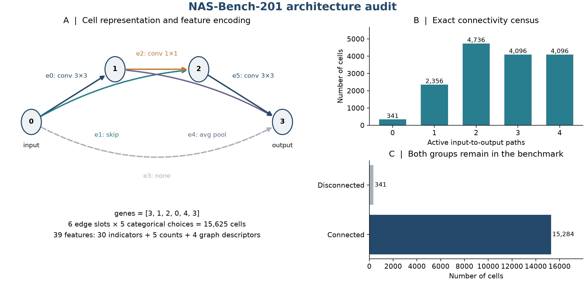

# ECSE541 · Effects of Error on Finding the Pareto Front · Final Project

We study how errors in predicted GPU latency affect architecture search and the Pareto front it discovers. NAS-Bench-201 supplies a finite reference space, so selected architectures can be evaluated against the same recorded values in every experiment.

**Part 1 is implemented:** benchmark loading, architecture encoding, and data checks. The repository includes the processed real data for all **15,625 architectures and 36,986 CIFAR-100 training trials**. Everyone writes their own methods/results; the other assigned parts extend this foundation.

## Start here

1. Clone this repository, or download its ZIP and extract it. Open a terminal in the directory containing this README and `pyproject.toml`.
2. Create a Python environment and install the package. Use Python 3.10 or later.

Windows PowerShell:

```powershell
python -m venv .venv
.venv\Scripts\python -m pip install -e .
.venv\Scripts\python -m ecse541_benchmark check data
.venv\Scripts\python examples/handoff.py
```

macOS / Linux:

```sh
python3 -m venv .venv
.venv/bin/python -m pip install -e .
.venv/bin/python -m ecse541_benchmark check data
.venv/bin/python examples/handoff.py
```

No environment activation is required. Below, `python` means the Python executable in your environment. The check verifies both table hashes and every recomputed aggregate. The example should report **15,625 eligible architectures**, objectives shaped **(15625, 2)**, and features shaped **(15625, 39)**. GPU training, PyTorch, and the original 5 GB file are unnecessary for using the bundled data. The first load performs full validation; load the benchmark once per process and reuse it across experiments.

## Shared data contract

```python
from ecse541_benchmark import Architecture, FEATURE_NAMES, load_benchmark

benchmark = load_benchmark("data")
ids = benchmark.eligible_ids
reference = benchmark.objectives(ids)
features = benchmark.features(ids)

cell = Architecture((3, 1, 2, 0, 4, 3))
arch_id = benchmark.id_for(cell)
single_reference = benchmark.objectives([arch_id])
predictions = reference.copy()
```

| Item | Meaning |
|---|---|
| `ids` | Official benchmark IDs, preserved without renumbering |
| `reference[:, 0]` | CIFAR-100 validation error in percentage points; minimize |
| `reference[:, 1]` | Recorded GPU batch latency in milliseconds; minimize |
| `features` | 39 features from architecture alone, aligned with `ids` |
| `cell.operations` | Six categorical genes, each in 0–4 |
| `cell.encoding_id` | Reversible base-five key; **different from the official ID** |

The benchmark uses `x-valid` at epoch index 199 of the 200-epoch schedule. Validation accuracy is averaged over available training seeds, then converted to error as `100 - accuracy`. Recorded latency is converted from seconds to milliseconds and represents a batch of 256, not per-image time. Returned arrays are copies; keep the recorded reference separate from predictions.

Use the same eligible IDs across every comparison. The training seeds 777/888/999 identify source training runs; they are separate from the random seeds for artificial errors and search experiments. No training seed is randomly resampled by the loader.



## Where each teammate starts

| Part | Starting inputs | Work to add |
|---|---|---|
| 1 · Benchmark foundation | This package, data, and audits | Implemented; preserve the shared contract when integrating |
| 2 · Reference front and metrics | `ids`, `reference`, data manifest | Exhaustive reference front, normalization, evaluation metrics, ties |
| 3 · Independent errors | Copy of `reference`, experiment seed | Generate one fixed predicted latency per ID/run; define error levels and sanity checks |
| 4 · Structured errors | Same inputs plus `features`, `FEATURE_NAMES` | Architecture-dependent errors and comparisons at matched error levels |
| 5 · Search and runner | Six genes → `Architecture` → `id_for` → objective query | Search algorithms, query budgets, experiment seeds, saved results |
| 6 · Related work and report | [Methods and measured results](METHODS.md), figures, audit JSON | Literature and integration, with each member contributing their methods/results |

For parts 3–4, initially modify latency column 1; keep validation error fixed. Generate the prediction table once per experiment seed and reuse it across search queries. For part 5, document how repeated queries count toward budgets. **GPU latency is the optimization objective, not the time required for a benchmark lookup.** Any simulated evaluation speedup must be a separately declared runner assumption.

## Data checks and findings

All architectures have usable values for both objectives. All 341 disconnected cell encodings remain present. Every exported objective mean matches the authors' API. Two source limitations are documented:

- **204 architectures have inconsistent parameter/FLOP metadata across training seeds.** Original trial values are preserved, auxiliary means follow the authors' API, and `cost_metadata_consistent` flags the affected rows. The 39 architecture features do not use those auxiliary measurements.
- **Latency entries are copied across training seeds.** Each trial stores one value; all 13,400 multi-seed architectures repeat the same latency entry. These are not independent timing repeats and cannot establish physical timing uncertainty. Artificial errors are sensitivity assumptions relative to the fixed recorded reference.

The three files in [`data/`](data/) belong together: `benchmark.csv` has one row per ID; `trials.csv` preserves per-seed observations; `manifest.json` fixes units, aggregation, schema, and checksums. Git preserves these bytes across operating systems.

Read [METHODS.md](METHODS.md) for the abstract, formulas, encoding, results, and references. The [measured-data figure](results/data_overview.png), [data audit](results/data_audit.json), and [verification record](results/verification.json) provide supporting evidence.

## Code and validation

| Location | Purpose |
|---|---|
| [`architecture.py`](ecse541_benchmark/architecture.py) | Strict parsing, reversible genes, categorical and graph features |
| [`extract.py`](ecse541_benchmark/extract.py), [`_stream.py`](ecse541_benchmark/_stream.py) | Original-file extraction with reduced memory use |
| [`benchmark.py`](ecse541_benchmark/benchmark.py) | Trial checks, aggregation, verified loading, team API |
| [`audit.py`](ecse541_benchmark/audit.py), [`__main__.py`](ecse541_benchmark/__main__.py) | Audits, figures, and CLI |
| [`examples/handoff.py`](examples/handoff.py) | Executable teammate walkthrough |
| [`tests/`](tests/) | Exhaustive encoding, serialization, integrity, and API checks |

```sh
python -m pip install -e ".[test]"
python -m pytest -q
python -m ecse541_benchmark audit data --out results
```

The full validation run includes optional PyTorch serialization and authors' API tests. If those dependencies are absent, five tests are explicitly skipped; core data use is unaffected. Install `torch` and the authors' `nas-bench-201` package to run those optional checks. The CI workflow is configured to check a fresh checkout, the real data, and the example on Linux and Windows. The recorded local handoff check used a fresh Windows checkout and an installed wheel; see the verification record for its environment and limits.

## Optional: rebuild from the original source

The processed tables are already included. To reproduce extraction, obtain the authors' [NAS-Bench-201 v1.1 file](https://drive.google.com/file/d/16Y0UwGisiouVRxW-W5hEtbxmcHw_0hF_/view), about 4.7 GiB:

```sh
python -m pip install -e ".[extract]"
python -m ecse541_benchmark download --out raw/NAS-Bench-201-v1_1-096897.pth
python -m ecse541_benchmark build --source raw/NAS-Bench-201-v1_1-096897.pth --out rebuilt_data --reports results --trust-source
```

`--trust-source` acknowledges pickle deserialization; use the trusted official download. `--expected-sha256 HASH` can enforce the fingerprint recorded in `data/manifest.json`. `--verify-api` compares every mean with the optional authors' API. Output data directories must be empty. See [source attribution and license notice](NOTICE).
